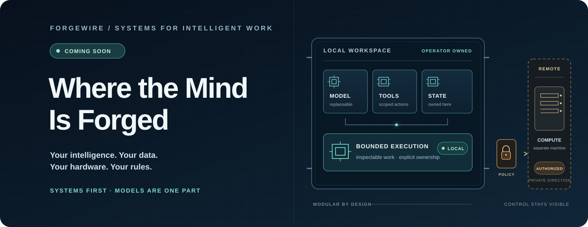
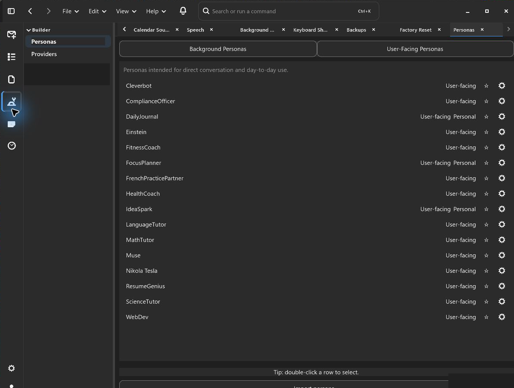
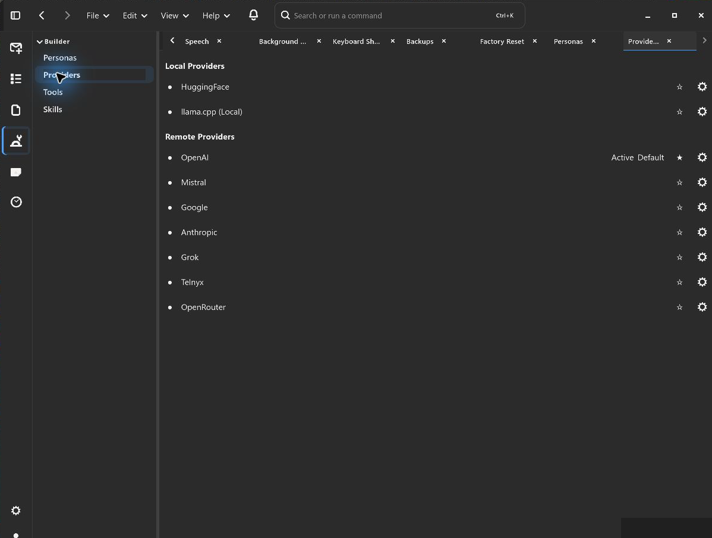
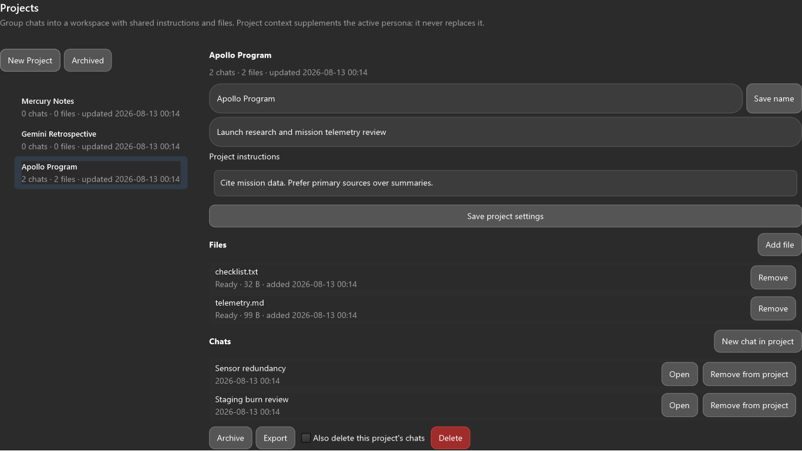
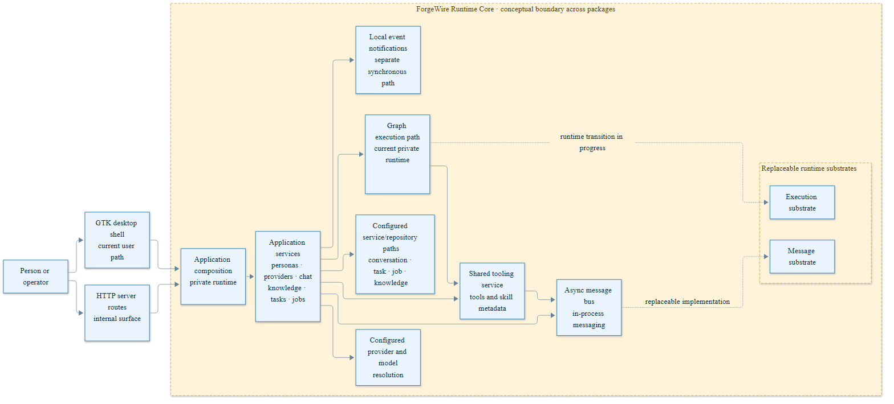
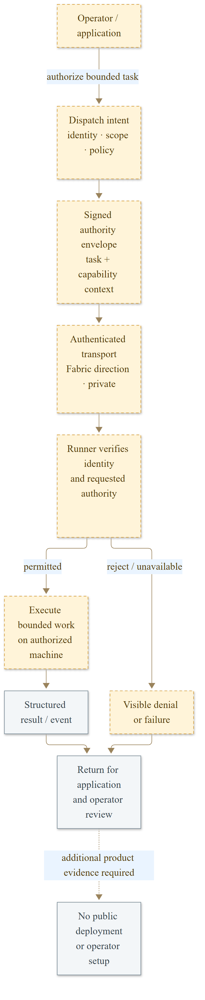

# ForgeWire

**Your intelligence. Your data. Your hardware. Your rules.**

ForgeWire is a modular AI workspace and orchestration system for bringing language models, personas, tools, knowledge, and compute together around real work.

The idea is simple: an AI system is more than the model answering a prompt. It also needs context, permissions, state, execution, and a way for people to understand and direct what happens. ForgeWire is built around those parts of the system rather than tying the entire experience to one model, service, or conversation window.

  <picture>
    <source media="(max-width: 640px)" srcset="assets/forgewire-hero-mobile.svg">
    
  </picture>

> **Agentic systems are systems first and models second.**

[Why ForgeWire](#why-forgewire) · [Inside the workspace](#inside-the-workspace) · [Architecture](#how-it-fits-together) · [ForgeWire Fabric](#forgewire-and-fabric) · [Availability](#availability)

## Why ForgeWire

Many AI products center on a chat window backed by a particular provider. That works well for conversation, but coordinated work has additional requirements. Different models have different strengths. Tools need boundaries. Knowledge must be selected rather than indiscriminately attached. Tasks need ownership, and failures need to be visible.

ForgeWire separates those responsibilities. A model supplies inference; a persona defines an operating identity and policy reference; tools perform bounded operations; services manage context and state; and selected workflows can delegate work through graph and agent execution paths.

That separation matters because it leaves room to change a provider, add a capability, or move execution without redesigning the entire application around the change.

The goal is **usefulness under constraint**: a system that remains understandable and controllable when its models, services, or hardware have limits.

## The design

| Principle | What it means |
| --- | --- |
| **Provider freedom** | Work with configured local or hosted models without making a single provider the foundation of the system. |
| **Operator control** | Keep model choices, capability access, data handling, and consequential actions within explicit workspace and policy boundaries. |
| **Composable capabilities** | Treat personas, tools, skills, agents, and services as distinct parts that can be connected for different kinds of work. |
| **Owned context** | Organize conversations and project materials while keeping knowledge retrieval, memory, and operational state separate. |
| **Replaceable infrastructure** | Make room for different execution and storage backends, including separately governed remote compute. |

These are architectural commitments, not a claim that every proposed integration is complete or available in every workspace.

## Inside the workspace

ForgeWire's current private application uses a GTK desktop interface. It brings conversation, projects, provider and persona selection, tools, knowledge, and operational views into a common workspace.

<table>
  <tr>
    <td width="50%" valign="top">
      
      <strong>Personas</strong> — distinct operating identities and their associated behavior and policy references.
    </td>
    <td width="50%" valign="top">
      
      <strong>Providers</strong> — model integrations and configuration kept separate from the rest of the workspace.
    </td>
  </tr>
</table>

*Projects view from a private GTK development build, rendered with disposable sample data. It shows the project workspace component, not a verified end-to-end session in the latest signed-in application.*

The interface also includes areas for tools, skills, knowledge, tasks and jobs, operations, and settings. Which services are usable depends on workspace configuration; the presence of a screen does not imply that every associated workflow is enabled.

## How it fits together

ForgeWire is organized as a set of cooperating responsibilities, not a single all-purpose agent.

- **Personas** provide interaction identity, behavioral settings, and policy references.
- **Providers and models** supply inference through configured local and hosted integrations.
- **Tools** expose bounded capabilities to read, transform, or interact with external systems.
- **Skills** describe reusable capabilities and compositions. Skill metadata exists; dynamic skill resolution remains under development.
- **Agents and graphs** support delegated and multi-step work in selected private workflows.
- **Knowledge, memory, and projects** provide different forms of context, rather than treating every piece of state as chat history.
- **Services, stores, and messaging** coordinate application state and operational events.

*The architecture distinguishes application composition from its supporting services and execution substrates. Some paths are configuration-dependent or still evolving.*

For a closer technical view, see the [capability composition diagram](assets/diagrams/capability-composition.png) ([Mermaid source](assets/diagrams/capability-composition.mmd)), [context and state diagram](assets/diagrams/context-and-state.png), and [task and recovery diagram](assets/diagrams/task-recovery.png).

## ForgeWire and Fabric

ForgeWire owns the meaning of the work: the user's request, application state, selected capabilities, and dispatch decisions.

**ForgeWire Fabric** is a separate distributed execution control plane being developed for authenticated, policy-gated work on remote machines. Its role is execution and placement, not ownership of the application's conversation, reasoning context, or task semantics.

That boundary is deliberate. The application should be able to choose *what* work is appropriate and under what authority, while an execution substrate handles *where and how* an authorized task runs.

*Fabric integration is private and configuration-dependent; this diagram explains the intended separation of responsibilities, not a publicly available deployment service.*

## Built to be inspected, directed, and changed

An agent proposing a tool call is not the same as an operator authorizing an action. A completed model response is not the same as durable task state. And a remote runner is not the owner of the workflow that dispatched it.

ForgeWire's architecture is shaped by those distinctions. Its ongoing engineering work emphasizes bounded capabilities, explicit ownership, observable failure, configurable dependencies, and recoverable execution where supported. The aim is not autonomy for its own sake; it is useful work that people can understand and govern.

## Availability

**ForgeWire is in private development.** There is no public application download, supported installation procedure, hosted service, or announced release date. This repository is a public overview; it does not contain the full application source.

The screenshots above show genuine private development interfaces, not a public release or a guarantee that every visible feature is operational. Detailed historical capture notes, limitations, and implementation observations are preserved in the [October 2026 technical snapshot](docs/2026-10-26-technical-snapshot.md), rather than mixed into this product introduction.

To follow a future release, use **Watch → Custom → Releases** on this repository or visit the [Releases page](https://github.com/ForgeWireLabs/ForgeWire-Overview/releases).

## Origins and related work

ForgeWire grew through **SCOUT → SCOUT-2 → ATLAS → PhrenForge → ForgeWire**, expanding from a multi-agent assistant into a broader application and orchestration architecture.

ForgeWire is designed and developed by [Jeremy Shows](https://github.com/JeremyShows) through [ForgeWire Labs](https://github.com/ForgeWireLabs), with AI coding agents contributing to research, implementation, testing, and documentation under human direction and review.

Related public work includes [SCOUT-2](https://github.com/ForgeWireLabs/SCOUT-2), [RepoPact Core](https://github.com/ForgeWireLabs/repopact-core), and [ForgeLink](https://github.com/JeremyShows/ForgeLink). Each project has its own scope and availability.

**Source and licensing:** Current private ForgeWire and Fabric development is proprietary unless a specific distribution explicitly states otherwise. Copies historically distributed under Apache License 2.0 retain the terms granted with those copies. This overview does not grant a license to private application or Fabric source.
