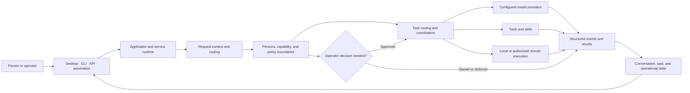
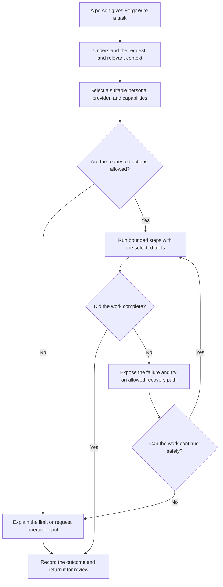

# ForgeWire

### Where the mind is forged

**Agentic systems are systems first and models second.**

ForgeWire is a modular environment under development for coordinating models, specialized agents, tools, memory, task execution, and compute around real work.

> **COMING SOON — PRIVATE DEVELOPMENT**
>
> ForgeWire is not available to download or install yet. There is no public source release, supported setup path, public API, or announced release date. This repository is the public overview.

[What ForgeWire is](#what-forgewire-is) · [How it works](#how-it-works) · [Development preview](#development-preview) · [Current status](#current-status) · [Follow updates](#follow-the-release)

---

## Start here

| If you want to… | Here’s what to do |
| --- | --- |
| Try ForgeWire today | You can’t yet. There is no public build or installation package. |
| Follow release news | On this repository, choose **Watch → Custom → Releases**. Star the repo to bookmark it. |
| Explore related public work | Visit [ForgeWire Labs](https://github.com/ForgeWireLabs), [RepoPact Core](https://github.com/ForgeWireLabs/repopact-core), or [ForgeLink](https://github.com/JeremyShows/ForgeLink). |
| Understand the project | Continue below. This page explains the intent, system boundaries, and present release status. |

**Please don’t treat screenshots or architecture diagrams on this page as a downloadable product or a promise that every described workflow is already available.** They show development direction.

---

## What ForgeWire is

ForgeWire is being built as a coordinated system for intelligent work—not as a single chatbot or model wrapper. Its intended building blocks include:

- model providers, including local and hosted options
- personas that define a role and operating boundaries
- tools for bounded actions
- skills that combine tools into repeatable workflows
- task routing and orchestration
- conversation, memory, and knowledge services
- local and distributed execution
- policy, operator decisions, and execution records

The goal is to let these parts work together while keeping their responsibilities visible and replaceable. Product reachability and feature coverage will be documented as they are validated for release.

### The ForgeWire thesis

> **Agentic systems are systems first and models second.**
>
> Survivability under deployment—graceful degradation, layered ownership, parity paths, audit trails, and replaceable substrates—is what makes an agentic system useful, not a benchmark score on a model card.

Models still matter. The system around them matters too: its state, boundaries, recovery paths, and record of what happened.

---

## How it works

The diagrams below describe the architectural direction. They are conceptual views; the implementation and the set of user-accessible paths continue to evolve.

### System view

### Intended task flow

This flow is a design goal, not a guarantee that all tasks are automated or that every recovery path is already implemented. Consequential actions should stay within explicit authority and may require a person to decide.

---

## Built around useful failure

Providers can be unavailable. Models can return poor results. Dependencies and hardware can fail. Remote work can disconnect. ForgeWire is being designed so those conditions become visible state that a person or operator can inspect.

The system is intended to support:

- **Graceful degradation:** optional components can fail without silently making the whole system appear healthy.
- **Clear ownership:** services, tools, and execution substrates have defined responsibilities.
- **Replaceable components:** model and infrastructure changes should not erase the surrounding workflow.
- **Parity paths:** alternative implementations should have comparable behavior and evidence.
- **Auditability:** meaningful actions and outcomes should leave a trace.
- **Human control:** an agent’s ability to propose an action does not grant it authority to perform that action.

These are engineering goals. A future release must document the controls and evidence that exist in the released build.

---

### Distributed execution

ForgeWire is being designed to support local work and authorized remote execution. A related project, **ForgeWire Fabric**, explores authenticated, policy-gated task execution across machines. Fabric is in private development; this overview contains no Fabric source or deployment access.

## Development preview

These are real screens from an internal ForgeWire setup build. They are included to make the project more concrete; they do not indicate public availability. The interface and setup flow may change before release.

<table>
  <tr>
    <td width="50%" valign="top">
      <strong>Guided setup</strong> 
      The welcome screen introduces the setup steps and separates required choices from optional configuration.  
      
    </td>
    <td width="50%" valign="top">
      <strong>Storage choices</strong> 
      The setup flow explains the local desktop option and shared-storage choice.  
      
    </td>
  </tr>
  <tr>
    <td colspan="2" valign="top">
      <strong>Local workspace boundary</strong> 
      The setup flow asks the operator to choose the folder where local Runner work may take place.  
      
    </td>
  </tr>
</table>

---

## Who this is for

ForgeWire is being developed for people who want to understand and shape the system around AI-assisted work:

- **Operators** who need control over where work runs and what actions are allowed.
- **Builders** connecting models, tools, services, and user workflows.
- **Researchers** evaluating agent systems under changing providers, constraints, and failure conditions.
- **Teams** exploring durable state and reviewable execution instead of relying on a conversation transcript alone.

It is not currently a hosted service, a supported enterprise deployment, or an open-source framework.

---

## Current status

| Area | Status |
| --- | --- |
| Public project overview | Available here |
| ForgeWire application source | Private development |
| Public download or installer | Not available |
| Supported installation instructions | Not available |
| Stable public API or compatibility promise | Not available |
| Public release date | Not announced |

This overview repo contains project information, not the ForgeWire application source. **Private development is proprietary unless a specific distribution is explicitly licensed otherwise.** Historical versions or copies previously distributed under Apache License 2.0 remain subject to the license terms that accompanied those specific versions or copies; current private development does not revoke rights already granted for historical distributions.

Before announcing a public release, ForgeWire will need clear installation instructions, supported-platform information, security and data-handling details, known limitations, and validation evidence for the released build. There is no waitlist or release date at this time.

---

## Follow the release

1. Select **Watch** near the top of this GitHub repository.
2. Choose **Custom**, then enable **Releases** to receive a notification if a release is published. See [GitHub’s notification guide](https://docs.github.com/en/subscriptions-and-notifications/get-started/configuring-notifications#configuring-your-watch-settings-for-an-individual-repository) for details. You can also open the [Releases page](https://github.com/ForgeWireLabs/ForgeWire-Overview/releases) directly.
3. Star the repo if you want to keep it in your GitHub bookmarks.
4. Revisit this README for the current status. A release will be announced here when one is ready.

For other public projects and research from the same independent engineering effort, visit [ForgeWire Labs](https://github.com/ForgeWireLabs). Related projects that are available separately include [RepoPact Core](https://github.com/ForgeWireLabs/repopact-core) and [ForgeLink](https://github.com/JeremyShows/ForgeLink); their status and terms are described in their own repositories.

---

## How ForgeWire is developed

ForgeWire is a human-led, deeply AI-assisted engineering and research effort led by [Jeremy Shows](https://github.com/JeremyShows) through [ForgeWire Labs](https://github.com/ForgeWireLabs). AI systems contribute materially across research, implementation, testing, review, and documentation. Jeremy works directly across that lifecycle, makes the technical decisions, integrates the work, and retains responsibility for architecture, validation, and acceptance.

The project draws on open research, open-source software, commercial AI tools, and established systems engineering. It does not claim unaided authorship or delegate technical responsibility wholesale to autonomous agents.

---

## Project lineage

ForgeWire grew through several generations of implementation and redesign:

**SCOUT → SCOUT-2 → ATLAS → PhrenForge → ForgeWire**

That path moved from a multi-agent assistant toward a broader system with tools, skills, permissions, services, structured events, execution boundaries, and repository-native governance. The history is part of the engineering record; it is not a claim that every earlier capability is present in the current product.

---

## In one sentence

ForgeWire is being built to make AI-assisted work more inspectable, bounded, recoverable, and useful when real systems and real constraints are involved.
